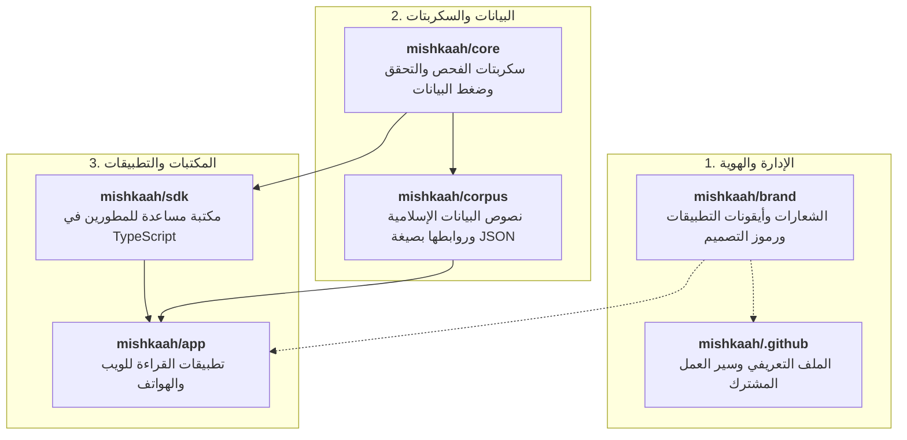

# مِشْكَاة · Mishkaah
### بيانات إسلامية مفتوحة ومُنظَّمة وتطبيقات قراءة موحدة

<div align="center">


[](https://github.com/mishkaah/corpus)
[](https://github.com/mishkaah/core)
[](https://github.com/mishkaah/brand)
[](https://github.com/mishkaah/sdk)
[](https://github.com/mishkaah/app)
[](https://github.com/mishkaah/core)

[English](./README.md) · **العربية**

</div>

---

## عن المشروع

**مِشْكَاة** هو مشروع وقفي مفتوح المصدر يهدف إلى جمع كل ما يحتاجه المسلم والباحث من النصوص الإسلامية الأصيلة والمحققة في منظومة موحدة:
- **القرآن الكريم**: النص العثماني برواية حفص عن عاصم مضبوطاً بالشكل التام مع الصرف التفصيلي لكل كلمة.
- **التفاسير المعتمدة**: تفاسير أئمة أهل السنة (الطبري، ابن كثير، القرطبي، السعدي).
- **الحديث الشريف**: كتب السنة المعتمدة (صحيح البخاري، صحيح مسلم، السنن) متضمنة سلاسل الأسانيد وتراجم الرواة ومراتبهم.
- **الأذكار والأدعية**: الأدعية النبوية الصحيحة من كتب السنة ومن *حصن المسلم*.
- **المتون العلمية وشروحها**: المتون والمنظومات التعليمية المحققة في العقيدة والفقه والحديث والتجويد والنحو والبلاغة مع شروحها.
- **المعاجم اللغوية التراثية**: منظومة معجمية ثلاثية الطبقات تربط الجذور اللغوية (*لسان العرب*، *مقاييس اللغة*)، وغريب القرآن (*المفردات للراغب*)، والتعريفات الاصطلاحية (*التعريفات للجرجاني*).
- **بيانات مفتوحة وتطبيقات متكاملة**: مستودع بيانات رقمية موثقة ومترابطة ([`mishkaah/corpus`](https://github.com/mishkaah/corpus))، وتطبيقات قراءة وبحث ميسرة وسريعة للويب والهواتف الذكية ([`mishkaah/app`](https://github.com/mishkaah/app)).

---

## الهوية البصرية وأيقونات التطبيقات

تعتمد مِشْكَاة على هوية بصرية هادئة وبسيطة تناسب جلال النصوص التراثية، مع توفير أيقونات متوافقة تقنيًا مع أنظمة الهواتف الحديثة (iOS 18 و Android):

<div align="center">

| الرمز الخطي | أيقونات التطبيقات للهواتف |
| :---: | :---: |
|  |  |
| **شعار مِشْكَاة**<br/>خط الثلث العربي الكلاسيكي | **أيقونات تطبيقات الهواتف (iOS 18 & Android)**<br/>نمط داكن، وفاتح، وألوان متكيفة داخل منطقة الأمان المعتمدة |

</div>

- **الألوان الأساسية**:
  - **الأسود الداكن** (`#09090B`) — خلفية هادئة مريحة للعين في القراءة الليلية.
  - **الذهبي الهادئ** (`#E5CFA0` ← `#B89655`) — عناصر التمييز الرئيسية والخط الأصيل.
  - **الورقي الفاتح** (`#F6F3EC`) — نمط القراءة النهاري المريح المستوحى من المخطوطات.
- تفاصيل الهوية الكاملة وملفات الرموز: [`mishkaah/brand`](https://github.com/mishkaah/brand).

---

## قواعد التدقيق الصارمة

لأننا نتعامل مع نصوص الوحي المعصوم (القرآن الكريم، والحديث النبوي الشريف) وكتب التراث العلمي المعتمدة، فإننا نحرص أشد الحرص على ألا تُحدث السكربتات البرمجية أو أدوات المعالجة أي تحريف أو خطأ، ولذلك نتبع قواعد تدقيق آلية صارمة:

### ١. توثيق المصدر بدقة (`SOURCES_MANIFEST.json`)
يُرْبَط كل نص يُضاف إلى المشروع بالطبعة المطبوعة أو المصدر المعتمد الذي أُخذ منه، مع تدوين بيانات الناشر والمحقق وتاريخ الطبعة.

### ٢. أولوية النص العربي وفصل الترجمات
تظل الملفات الأساسية نصوصًا عربية خالصة مضبوطة بالشكل (`matns/`، `explanations/`، `entities/`، `lexicons/`)، بينما تُحفظ الترجمات في ملفات مستقلة (`corpus/translations/{lang}/`) ترتبط بالنص العربي عبر معرّف المورد (`target_urn`)، حتى لا تختلط الترجمات بالنصوص الأصلية.

### ٣. روابط داخلية غير مشوّهة للنص
عند الإشارة إلى شخص أو مكان أو جماعة أو واقعة أو مصطلح، يُستخدم رابط داخلي مثل `[النص](mishkah:...)` يخضع لقاعدة برمجية صارمة:
```ts
stripInlineRefs(text_annotated_ar) === text_ar
```
بحيث تعود الكلمات إلى نصها الأصلي تمامًا عند نزع الروابط دون تغيير أي حرف.

### ٤. المنظومة المعجمية ثلاثية الطبقات
- **الطبقة الأولى (`lexicons/roots/`)**: جذور الألفاظ في المعاجم التراثية (*مقاييس اللغة*، *لسان العرب*).
- **الطبقة الثانية (`lexicons/meanings/`)**: المعاني السياقية وغريب القرآن والحديث (*المفردات للراغب الأصفهاني*).
- **الطبقة الثالثة (`entities/terms/`)**: المصطلحات الشرعية التخصصية (*التعريفات للجرجاني*).

### ٥. معايير برمجية منضبطة في TypeScript و Bun
تُكتب جميع سكربتات التنسيق والتدقيق بلغة TypeScript لبيئة Bun باستخدام مخططات Zod صارمة (`.strict()`) دون استخدام `any` أو `unknown`.

### ٦. تدقيق برمجي آلي واختبارات ذاتية للتحقق
يخضع كل تغيير لفحص آلي للتأكد من صحة المخططات وسلامة الروابط وتطابق المصادر. كما تُختبر أدوات التدقيق نفسها ضد عينات بيانات غير صالحة للتأكد من يقظتها وعدم تعطلها.

### ٧. إدارة العمل عبر المسائل الموثقة
تتم التعديلات والمراجعات عبر مسائل واضحة (GitHub Issues) وطلبات سحب محددة النطاق ليتمكن الجميع من المتابعة والمساهمة بسهولة ووضوح.

---

## خريطة المستودعات

يتوزع المشروع على ٦ مستودعات مترابطة:



| # | المستودع | الوصف | التقنيات المستخدمة |
| :---: | :--- | :--- | :--- |
| **1** | [**`mishkaah/.github`**](https://github.com/mishkaah/.github) | واجهة المنظمة وإرشادات العمل وسير عمل GitHub Actions المشتركة. | Markdown, GitHub Actions |
| **2** | [**`mishkaah/brand`**](https://github.com/mishkaah/brand) | الشعارات وأيقونات تطبيقات الهواتف ورموز التصميم بصيغة JSON. | SVG, High-Res PNG, JSON Tokens |
| **3** | [**`mishkaah/corpus`**](https://github.com/mishkaah/corpus) | نصوص البيانات الإسلامية وروابط الكيانات والمعاجم والترجمات بصيغة JSON. | 100% Arabic JSON, Git Submodule |
| **4** | [**`mishkaah/core`**](https://github.com/mishkaah/core) | سكربتات TypeScript و Bun لتنسيق البيانات وتدقيقها وتجميعها في قاعدة بيانات SQLite. | TypeScript, Bun, Zod, SQLite |
| **5** | [**`mishkaah/sdk`**](https://github.com/mishkaah/sdk) | مكتبة برمجية مساعدة للتعامل مع معرّفات URNs وروابط النصوص وبيانات المشروع. | TypeScript, Bun, npm package |
| **6** | [**`mishkaah/app`**](https://github.com/mishkaah/app) | تطبيقات ميسرة للقراءة والبحث في نصوص المشروع عبر الويب والهواتف. | Flutter / Modern Web |

---

## المساهمة والوقف العلمي

إن نصوص الوحي وكتب التراث الإسلامي المودعة في هذا المستودع هي ميراث الأمة ومتاحة كوقف علمي مفتوح المصدر لخدمة عموم المسلمين والباحثين حول العالم.

نرحب بمساهمة الباحثين والمحققين والمطورين لمساعدتنا في تدقيق النصوص وتطوير الأدوات. يُرجى الاطلاع على [دليل تنظيم العمل](https://github.com/mishkaah/core/blob/main/docs/01-governance/workflow-and-issues.md) و[إرشادات المساهمة في البيانات](https://github.com/mishkaah/corpus/blob/main/docs/contributing.md) قبل فتح أي طلب سحب.
