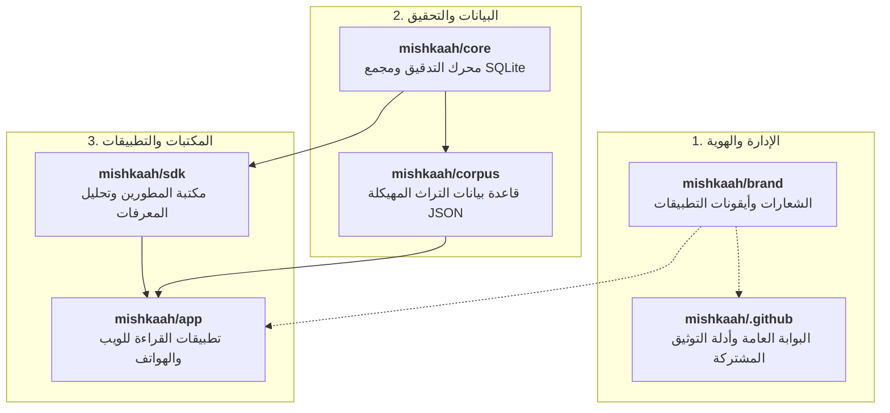

# مِشْكَاة · Mishkaah
### قاعدة بيانات التراث الإسلامي المفتوحة وتطبيقات القراءة الموحدة

**العربية** · [English](./README.md)

---

## 1. مرحباً بك في مشكاة

**مشكاة** هي مبادرة وقفية مفتوحة لجمع، وضبط، وربط، وإتاحة جميع مصادر المعرفة الإسلامية الأصيلة التي يحتاجها المسلم والباحث وطالب العلم — في تجربة قراءة هادئة خالية من المشتتات، وقاعدة بيانات مهيكلة ومحققة علمياً:

- **نحن أمناء وناقلون ولسنا مصنفين**: لا نؤلف نصوصاً، ولا نولد محتوى بالذكاء الاصطناعي. كل آية، وحديث، وتفسير، ومتن علمي، وشرح، ومفردة لغوية تُعزى بالكامل إلى طبعة مطبوعة محققة معتمدة مع توثيق اسم المحقق، ودار النشر، وتاريخ الطبع، والجزء ورقم الصفحة.
- **تراث موحد ومترابط**: نجمع بين القرآن الكريم، وكتب الحديث الشريف بأسانيدها وتراجم رواتها، والتفاسير المعتمدة، والمتون العلمية وشروحها، والأذكار المأثورة، والأعلام والبلدان، والمعاجم اللغوية بثلاث طبقات متدرجة.
- **سكينة وتركيز في القراءة**: صُممت الواجهات بعناية فائقة لتناسب ساعات القراءة الطويلة والبحث العلمي الرصين على الويب والهواتف الذكية دون أي مشتتات.

---

## 2. ابدأ من هنا: اختر مسارك بحسب اهتمامك

استكشف مشكاة بحسب رغبتك والتخصص الذي يهمك:

| ما تبحث عنه / سؤالك | الدليل الإرشادي المعتمد | ماذا ستجد في هذا الدليل؟ |
| :--- | :--- | :--- |
| 🔍 **"كيف أتأكد أن هذه النصوص محققة ومحمية من التحريف والخطأ؟"** | [**برهان الدقة: كيف تصون مشكاة النصوص الشرعية**](https://github.com/mishkaah/.github/blob/main/docs/data-accuracy-and-protection.ar.md) | الختم الرقمي المشفر للقرآن الكريم (`quran_hafs_seal.json`)، وتوثيق الطبعات المحققة، وجناح أفخاخ الفساد الـ 28، وشرط المراجعة المستقلة (`Reviewer != Author`). |
| ✍️ **"كيف أبلغ عن خطأ تشكيلي، أو أراجع نصاً، أو أقترح كتاباً (دون برمجة)؟"** | [**دليل المساهمين من العلماء والمدققين اللغويين**](https://github.com/mishkaah/.github/blob/main/docs/non-technical-contributing.ar.md) | خطوات سهلة للعلماء وطلبة العلم والمدققين. افتح الاستمارات مباشرة: [الإبلاغ عن خطأ](https://github.com/mishkaah/.github/issues/new?template=01-report-text-error.yml) · [اقتراح مصدر محقق](https://github.com/mishkaah/.github/issues/new?template=02-propose-new-source.yml) · [طلب التطوع في المراجعة](https://github.com/mishkaah/.github/issues/new?template=03-volunteer-or-contribute.yml). |
| ⚙️ **"مهندس برمجيات، أو خبير بيانات، أو باحث تقني؟"** | [**الدليل التقني والمعمارية البرمجية**](https://github.com/mishkaah/.github/blob/main/docs/technical-architecture.ar.md) | كود TypeScript صارم 100% مع بيئة Bun 1.4، ومخططات Zod مغلقة، ونظام التدقيق الجنائي الطبقي صفر، وشبكة المعرفات URNs، واستوديو التحرير المرئي، ومجمع SQLite FTS5 للبحث دون اتصال. |
| 🎨 **"تريد الاطلاع على الهوية البصرية وتصميم أيقونات التطبيقات؟"** | [**الهوية البصرية وأيقونات التطبيقات**](#4-الهوية-البصرية-وحزمة-أيقونات-التطبيقات) | خط الثلث الديواني الأصيل، وأيقونات أنظمة iOS 18 وAndroid التكيفية، وألوان القراءة الليلية والنهارية. |

---

## 3. ما نجمعه ونربطه من التراث الإسلامي

تنتظم مصادر المعرفة في مشكاة عبر سبعة مجالات علمية متصلة:

1. **القرآن الكريم**: النص العثماني المحكم برواية حفص عن عاصم وفق مصحف مجمع الملك فهد لطباعة المصحف الشريف، مع الضبط التام وصرف الكلمات وبنيتها الصرفية.
2. **الحديث النبوي الشريف**: كتب السنة المشرفة (*صحيح البخاري*، *صحيح مسلم*، كتب السنن) مع إثبات سلاسل الأسانيد كاملة وتراجم الرواة.
3. **التفاسير المعتمدة**: أمهات تفاسير أهل السنة والجماعة (تفسير الطبري، وابن كثير، والقرطبي، والسعدي) مربوطة آية بآية.
4. **الأذكار والأدعية النبوية**: أذكار الصباح والمساء والصلوات والأحوال اليومية من صحيح السنة النبوية ومن كتاب *حصن المسلم*.
5. **المتون العلمية والشروح**: أمهات المنظومات والرسائل التعليمية التراثية في العقيدة، والفقه، والتجويد، ومصطلح الحديث، والنحو والصرف.
6. **شبكة الأعلام والكيانات**: تراجم مفصلة لأكثر من 49 علماً من الصحابة والأئمة، وأطلس المواضع الجغرافية، والوقائع الكبرى.
7. **المعاجم اللغوية ثلاثية الطبقات**: نظام معجمي يربط اللفظ بجذوره الاشتقاقية (*لسان العرب*، *مقاييس اللغة*)، ثم بألفاظ القرآن وسياقاته (*المفردات في غريب القرآن للأصفهاني*)، ثم بمصطلحات العلوم (*التعريفات للجرجاني*).

---

## 4. الهوية البصرية وحزمة أيقونات التطبيقات

تجمع مشكاة بين بهاء الخط العربي الأصيل وهندسة البرمجيات المعاصرة، مع تصميم أيقونات دقيقة متوافقة مع أحدث إرشادات أنظمة التشغيل (iOS 18 وAndroid 13–15):

| الشعار الخطي | حزمة أيقونات التطبيقات |
| :---: | :---: |
|  |  |
| **شعار مشكاة الخطي** خط الثلث الديواني الأصيل بروح معاصرة | **أيقونات تطبيقات الهواتف (iOS 18 وAndroid)** الأنماط الداكنة والفاتحة والمصبوغة مضبوطة ضمن مناطق الأمان |

- **لوحة الألوان الأساسية**:
  - **السواد الحجري المطفي** (`#09090B`): مساحة داكنة مريحة للعين في القراءة الليلية.
  - **الذهب التراثي** (`#E5CFA0` ← `#B89655`): بريق الخط والتطريز في المخطوطات القديمة.
  - **بياض الرق التراثي** (`#F6F3EC`): محاكاة لورق المخطوطات في القراءة النهارية.
- الأصول التصميمية الكاملة والموجهات: [`mishkaah/brand`](https://github.com/mishkaah/brand).

---

## 5. كيف نضمن الدقة وصون النصوص من الخلل

لأننا نتناول كلام رب العالمين وسنة نبيه صلى الله عليه وسلم وتراث علماء الأمة، فإن ضبط النصوص محمي بأنظمة تدقيق آلية محكمة:

1. **الختم الرقمي لرواية حفص**: تُقفل كل سورة ببصمتين تشفيريتين رقميتين من نوع (SHA-256). وأي خطأ في حرف أو حركة يؤدي إلى رفض التحديث فوراً.
2. **سجل المصادر المحققة (`SOURCES_MANIFEST.json`)**: كل نص مربوط بطبعة معتمدة مع توثيق المحقق، والدار، والجزء، والصفحة.
3. **معادلة الربط الدلالي غير المخل**: `stripInlineRefs(text_annotated_ar) === text_ar`؛ لا تجيز وسوم الأعلام إحداث أي تغيير في النص الأصلي.
4. **المستويات الأمنية الثلاثة للملفات**: الملفات المفهرسة آلياً لا تُعدل باليد، وبيانات التراث تقابل على الطبعات المعتمدة، وأدوات الفحص مقفلة تشفيرياً.
5. **نظام التدقيق الطبقي صفر**: فحص آلي لشجرة الكود لحظر أي تساهل برمجي، مع 28 فخ فساد اختباري بنسبة كشف 100%.
6. **اشتراط المراجعة المزدوجة المستقلة**: يمنع النظام الآلي دمج أي تعديل إلا بعد مراجعته من شخص آخر مغاير للمؤلف (`Reviewer != Author`).

للاطلاع على البيان التوثيقي الكامل، راجع [**برهان الدقة: كيف تصون مشكاة النصوص الشرعية**](https://github.com/mishkaah/.github/blob/main/docs/data-accuracy-and-protection.ar.md).

---

## 6. منظومة المستودعات الستة وحالة الإتاحة

تنقسم منظومة مشكاة إلى ستة مستودعات متخصصة:

| المستودع | الغرض والمهمة | التقنيات الأساسية | حالة الإتاحة |
| :--- | :--- | :--- | :--- |
| [**`mishkaah/.github`**](https://github.com/mishkaah/.github) | البوابة العامة للمنظمة، والأدلة التوثيقية، ونماذج البلاغات، وإجراءات CI المشتركة | Markdown, YAML | **عام (Public)** |
| [**`mishkaah/brand`**](https://github.com/mishkaah/brand) | الهوية البصرية، والخطوط الثلثية، وحزم أيقونات التطبيقات المتوافقة مع أنظمة iOS 18 وAndroid | SVG, PNG, JSON Tokens | خاص (تجهيز) |
| [**`mishkaah/corpus`**](https://github.com/mishkaah/corpus) | قاعدة البيانات المهيكلة لنصوص التراث (القرآن، التفاسير، الحديث، المتون، المعاجم) | 100% Arabic JSON | خاص (تجهيز) |
| [**`mishkaah/core`**](https://github.com/mishkaah/core) | أدوات التحقق في TypeScript، ومجمع قواعد SQLite FTS5، واستوديو التحرير المرئي | TypeScript, Bun, SQLite | خاص (تجهيز) |
| [**`mishkaah/sdk`**](https://github.com/mishkaah/sdk) | مكتبة برمجية (`@mishkaah/sdk`) لتحليل معرفات URNs وتجريد الروابط واستعراض الشبكة الدلالية | TypeScript, Bun | خاص (تجهيز) |
| [**`mishkaah/app`**](https://github.com/mishkaah/app) | تطبيقات القراءة والبحث الموحدة للويب والهواتف مع قاعدة بيانات محلية تعمل دون اتصال | Flutter, SQLite, Web | خاص (تجهيز) |

> [!NOTE]
> يمثل مستودع `mishkaah/.github` الواجهة والباب المفتوح للمنظمة حالياً، بينما تخضع مستودعات البيانات والتطبيقات (`brand` و`corpus` و`core` و`sdk` و`app`) لعمليات تدقيق جنائي وتحقيق علمي مكثف في بيئة خاصة، وستُتاح للعموم كوقف علمي مكتمل ومصون بإذن الله.

---

## 7. الوقف العلمي والمساهمة في المشروع

إن نصوص الوحيين الشريفين والتراث العلمي المحقق هي ميراث النبوة وملك عام للأمة، ونحن نقوم عليها وقفاً علمياً لله تعالى لا نبتغي من ورائه إلا حفظ الدين وخدمة المسلمين والباحثين.

نرحب بكل عالم، وباحث، ومراجع، ومدقق، ومطور يرغب في المشاركة في هذا الأجر:
- للعلماء والمدققين: راجع [**دليل المساهمين غير التقنيين**](https://github.com/mishkaah/.github/blob/main/docs/non-technical-contributing.ar.md).
- للمهندسين والمطورين: راجع [**الدليل التقني والمعمارية البرمجية**](https://github.com/mishkaah/.github/blob/main/docs/technical-architecture.ar.md).
- للإبلاغ عن خطأ أو اقتراح طبعة محققة، تفضل بزيارة [**نماذج البلاغات الرسمية**](https://github.com/mishkaah/.github/issues/new/choose).
