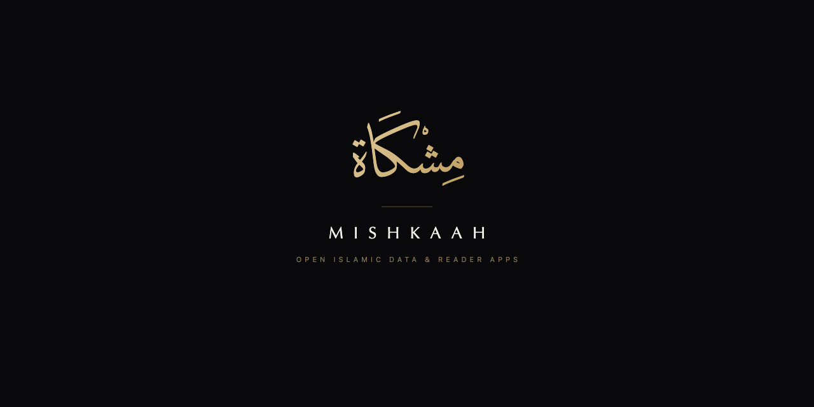
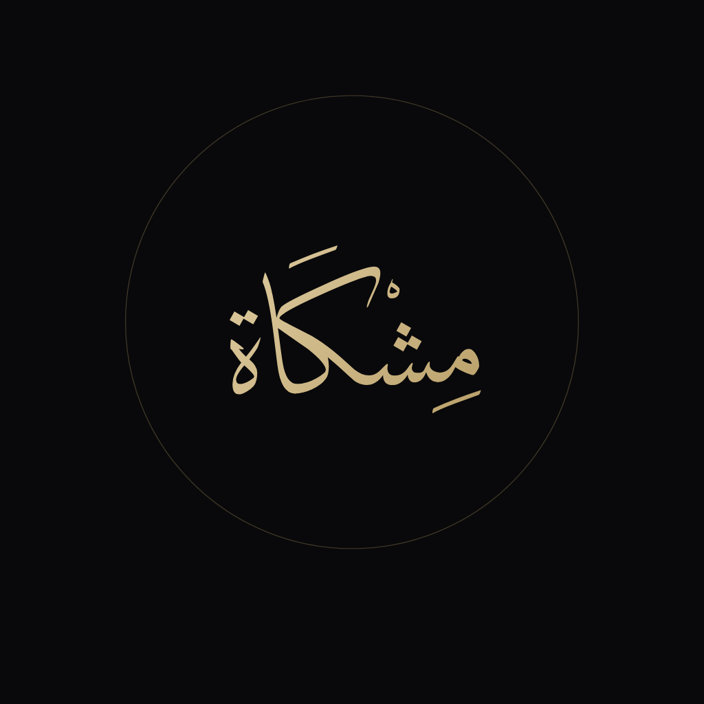
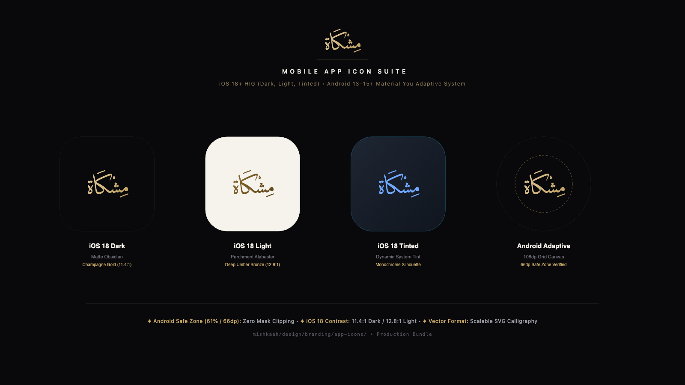
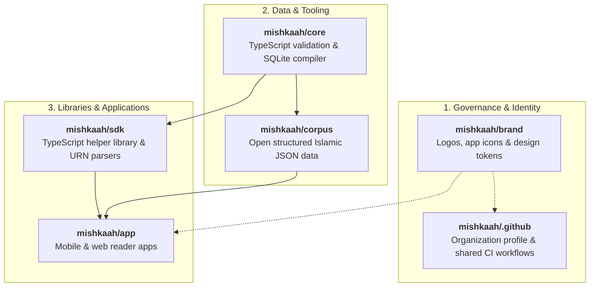

# Mishkaah · مِشْكَاة
### Open, Structured Islamic Data & Reader Applications

<div align="center">



[](https://github.com/mishkaah/corpus)
[](https://github.com/mishkaah/core)
[](https://github.com/mishkaah/brand)
[](https://github.com/mishkaah/sdk)
[](https://github.com/mishkaah/app)
[](https://github.com/mishkaah/core)

**English** · [العربية](./README.ar.md)

</div>

---

## Overview

**Mishkaah** is an open-source initiative that brings together all authentic Islamic materials a Muslim needs into a single unified ecosystem:
- **Holy Quran**: Canonical Hafs text with authentic Uthmani script and word-level morphology.
- **Tafseer**: Classical exegeses (Al-Tabari, Ibn Kathir, Al-Qurtubi, Al-Sa'di).
- **Hadith**: Canonical collections (*Sahih al-Bukhari*, *Sahih Muslim*, Sunan) with transmission chains (*Asanid*) and narrator biographies.
- **Adhkar & Du'a**: Authentic daily supplications from the Sunnah and *Hisn al-Muslim*.
- **Scientific Matns & Shuruh**: Classical didactic primers and explanatory commentaries across Aqeedah, Fiqh, Tajweed, Hadith terminology, and Arabic grammar.
- **Classical Arabic Lexicons**: Three-layer lexical system linking triliteral roots (*Lisan al-Arab*, *Maqayis al-Lughah*), contextual Qur'anic meanings (*Al-Mufradat fi Gharib al-Quran*), and technical juristic terms (*Al-Ta'rifat*).
- **Unified Apps & Datasets**: Backed by verified open data in [`mishkaah/corpus`](https://github.com/mishkaah/corpus) and presented in a clean, distraction-free web and mobile reading app in [`mishkaah/app`](https://github.com/mishkaah/app).

---

## Visual Identity & App Icons

Mishkaah embraces a calm, museum-grade aesthetic honoring the dignity of classical Islamic texts, paired with mobile icons engineered to avoid mask-clipping on modern operating systems (iOS 18+ HIG and Android 13–15+ Adaptive Icons):

<div align="center">

| Calligraphic Mark | Mobile App Icon Suite |
| :---: | :---: |
|  |  |
| **Mishkaah Sovereign Mark**<br/>Classical Arabic *Diwan Thuluth* calligraphy | **Mobile App Icons (iOS 18 & Android)**<br/>Dark, Light, and Tinted modes strictly confined within safe zones |

</div>

- **Core Palette**:
  - **Matte Obsidian** (`#09090B`) — Canonical dark canvas providing calm negative space for night reading.
  - **Champagne Gold** (`#E5CFA0` → `#B89655`) — Warm calligraphic highlight and primary brand accent.
  - **Parchment Alabaster** (`#F6F3EC`) — Day reading mode inspired by classical manuscript paper.
- Comprehensive brand assets, guidelines, and design tokens: [`mishkaah/brand`](https://github.com/mishkaah/brand).

---

## Strict Verification Principles

Because we handle sacred Islamic scriptures and verified scholarly heritage, Mishkaah strictly enforces automated verification to prevent typographical errors, omissions, or unverified additions:

### 1. Rigorous Source Provenance (`SOURCES_MANIFEST.json`)
Every text added to the corpus is tied to an authoritative printed edition or verified manuscript, documenting publisher, editor (*Muhaqqiq*), edition year, and volume.

### 2. Arabic-First & Stand-Off Translations
Primary files are 100% classical Arabic with full diacritics (`matns/`, `explanations/`, `entities/`, `lexicons/`). Foreign language translations are kept in separate stand-off overlays (`corpus/translations/{lang}/`), linking 1-to-1 via canonical URNs (`target_urn`). This enables multi-language expansion without merge conflicts or altering Arabic originals.

### 3. Non-Disruptive Inline Referencing
Biographical and terminological mentions are linked using Markdown syntax `[النص](mishkah:...)`, governed by the strict invariant:
```ts
stripInlineRefs(text_annotated_ar) === text_ar
```
Stripping reference tags reconstructs the clean canonical Arabic text byte-for-byte.

### 4. Three-Layer Connected Lexicons
Unfamiliar vocabulary connects directly to:
- **Layer 1 (`lexicons/roots/`)**: Triliteral and quadriliteral roots in major dictionaries (*Lisan al-Arab*, *Maqayis al-Lughah*).
- **Layer 2 (`lexicons/meanings/`)**: Contextual Quranic and Hadith definitions (*Gharib al-Quran* by Al-Raghib al-Isfahani).
- **Layer 3 (`entities/terms/`)**: Technical scholarly terminology (*Al-Ta'rifat* by Al-Jurjani).

### 5. Strict TypeScript & Bun Architecture
All tooling, validators, and compilers are written in strict TypeScript for Bun 1.4 with zero escape hatches: `0` `any`, `0` `unknown`, `0` `.passthrough()`, and every Zod schema ends with `.strict()`.

### 6. Layer 0 Meta-Validation
The validation pipeline protects itself using AST guards, cryptographic lockfiles (`validator_lock.json`), and 25 synthetic canary payloads to ensure validators cannot be weakened or bypassed.

### 7. Issue-Driven Workflow
Every modification maps to a well-scoped GitHub issue and qualified pull request.

---

## Ecosystem Repositories

The project is structured across 6 focused repositories:



| # | Repository | Description | Technologies |
| :---: | :--- | :--- | :--- |
| **1** | [**`mishkaah/.github`**](https://github.com/mishkaah/.github) | Organization profile, community standards, and shared GitHub Actions workflows. | Markdown, GitHub Actions |
| **2** | [**`mishkaah/brand`**](https://github.com/mishkaah/brand) | Visual identity, calligraphic marks, iOS/Android adaptive app icons, and JSON design tokens. | SVG, High-Res PNG, JSON Tokens |
| **3** | [**`mishkaah/corpus`**](https://github.com/mishkaah/corpus) | Open structured JSON dataset of authentic Islamic texts: Quran, Tafseer, Hadith, Matns, Entities, and Lexicons. | 100% Arabic JSON, Git Submodule |
| **4** | [**`mishkaah/core`**](https://github.com/mishkaah/core) | Strict TypeScript, Bun, and Zod validation, formatting, and SQLite FTS5 compilation tooling for the Mishkaah corpus. | TypeScript, Bun, Zod, SQLite |
| **5** | [**`mishkaah/sdk`**](https://github.com/mishkaah/sdk) | TypeScript SDK (`@mishkaah/sdk`) for parsing Mishkaah URNs, resolving inline entity links, and querying corpus data. | TypeScript, Bun, npm package |
| **6** | [**`mishkaah/app`**](https://github.com/mishkaah/app) | Unified web and mobile reading and search app for the Quran, Hadith, Tafseer, Adhkar, and classical Islamic texts. | Flutter / Modern Web |

---

## Contributing & Scholarly Waqf

The foundational Islamic texts, classical commentaries, and linguistic works in this corpus constitute the public domain heritage of Islam, maintained as an open scholarly endowment (*Waqf*) for the global Muslim Ummah and research community.

Scholars, researchers, and developers are welcome to contribute. Please review the [Governance Guide](https://github.com/mishkaah/core/blob/main/docs/01-governance/workflow-and-issues.md) and [Contributing Guidelines](https://github.com/mishkaah/corpus/blob/main/docs/contributing.md) before submitting pull requests.
