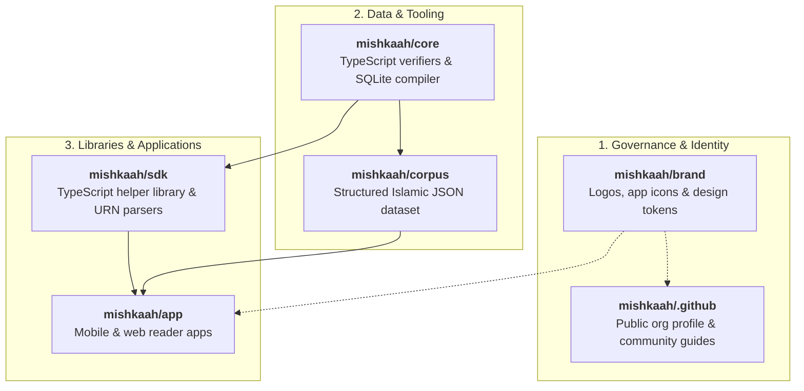

# Mishkaah · مِشْكَاة
### Open, Structured Islamic Data & Reader Applications

**English** · [العربية](./README.ar.md)

---

## 1. Welcome to Mishkaah

**Mishkaah** is an open-source initiative dedicated to collecting, rigorously formatting, linking, and serving all authentic Islamic materials a Muslim needs in daily study and worship — into a unified, distraction-free reading experience and an open structured dataset:

- **We Are Stewards and Collectors, Never Authors**: We never generate, paraphrase, or invent religious texts. Every single verse, hadith, explanation, primer, and lexical meaning traces to an authenticated printed critical edition with documented publishers, editors (*Muhaqqiqoon*), and years of publication.
- **Unified Heritage**: We connect the Holy Quran, authentic Hadith collections with narrator transmission chains (*Asanid*), classical Tafseer, didactic scientific primers (*Mutun*), explanatory commentaries (*Shuruh*), daily Adhkar, historical figures, and three-layer classical Arabic lexicons.
- **Calm, Distraction-Free Experience**: Built for quiet study, deep contemplation, and scholarly research on web and mobile devices.

---

## 2. Start Here: Choose Your Path

Explore Mishkaah based on your questions and interest:

| Your Interest / Question | Recommended Resource | What You Will Find |
| :--- | :--- | :--- |
| 🔍 **"How do I know this data is authentic and protected from error?"** | [**How We Verify & Protect Sacred Data**](https://github.com/mishkaah/.github/blob/main/docs/data-accuracy-and-protection.md) | Cryptographic Quran seal (`quran_hafs_seal.json`), verified printed editions, 28-pill poison canaries, and mandatory two-person review (`Reviewer != Author`). |
| ✍️ **"How can I report a typo, verify texts, or propose a book (No coding required)?"** | [**Non-Technical Contributor & Scholar Guide**](https://github.com/mishkaah/.github/blob/main/docs/non-technical-contributing.md) | Step-by-step instructions for scholars, proofreaders, and readers. Open forms directly: [Report Text Issue](https://github.com/mishkaah/.github/issues/new?template=01-report-text-error.yml) · [Propose Source](https://github.com/mishkaah/.github/issues/new?template=02-propose-new-source.yml) · [Volunteer to Review](https://github.com/mishkaah/.github/issues/new?template=03-volunteer-or-contribute.yml). |
| ⚙️ **"Developer, Engineer, or Data Researcher?"** | [**Technical Architecture & Tooling Guide**](https://github.com/mishkaah/.github/blob/main/docs/technical-architecture.md) | 100% strict TypeScript + Bun 1.4, `.strict()` Zod contracts, Layer 0 Meta-Validator, URN knowledge graph, Visual Studio GUI, and SQLite FTS5 compiler. |
| 🎨 **"Interested in our visual identity and mobile app icons?"** | [**Visual Identity & Mobile App Icons**](#4-visual-identity--app-icons) | Classical Arabic Diwan Thuluth marks, iOS 18 & Android adaptive icons, and night/day palettes. |

---

## 3. What Materials We Collect & Connect

Mishkaah organizes Islamic scholarship across seven deeply interconnected domains:

1. **Holy Quran**: Canonical Hafs recension following the King Fahd Glorious Quran Printing Complex with full Uthmani vocalization and word-by-word morphology.
2. **Hadith & Sunnah**: Canonical Hadith collections (*Sahih al-Bukhari*, *Sahih Muslim*, Sunan) preserving complete transmission chains (*Asanid*) and narrator biographies.
3. **Tafseer**: Classical Quranic commentaries (Al-Tabari, Ibn Kathir, Al-Qurtubi, Al-Sa'di) aligned ayah-by-ayah.
4. **Adhkar & Supplications**: Authentic morning, evening, prayer, and daily supplications from the Sunnah and *Hisn al-Muslim*.
5. **Scientific Matns & Shuruh**: Classical didactic primers and explanatory commentaries across Aqeedah, Fiqh, Tajweed, Hadith terminology, and Arabic grammar.
6. **Universal Entity Graph**: Biographies of 49+ prominent historical figures, Companions, sacred places, and key historical milestones linked seamlessly.
7. **Three-Layer Arabic Lexicons**: Comprehensive vocabulary lookup linking triliteral roots (*Lisan al-Arab*, *Maqayis al-Lughah*), Quranic contextual meanings (*Al-Mufradat fi Gharib al-Quran*), and technical definitions (*Al-Ta'rifat*).

---

## 4. Visual Identity & App Icons

Mishkaah embraces a clean, minimal visual aesthetic honoring the dignity of classical Islamic texts, paired with mobile icons engineered to avoid mask-clipping on modern operating systems (iOS 18+ HIG and Android 13–15+ Adaptive Icons):

| Calligraphic Mark | Mobile App Icon Suite |
| :---: | :---: |
|  |  |
| **Mishkaah Calligraphic Mark** Classical Arabic *Diwan Thuluth* calligraphy | **Mobile App Icons (iOS 18 & Android)** Dark, Light, and Tinted modes strictly confined within safe zones |

- **Core Palette**:
  - **Matte Obsidian** (`#09090B`) — Canonical dark canvas providing calm negative space for night reading.
  - **Champagne Gold** (`#E5CFA0` → `#B89655`) — Warm calligraphic highlight and primary brand accent.
  - **Parchment Alabaster** (`#F6F3EC`) — Day reading mode inspired by classical manuscript paper.
- Comprehensive brand assets, guidelines, and design tokens: [`mishkaah/brand`](https://github.com/mishkaah/brand).

---

## 5. How We Guarantee Accuracy & Prevent Errors

Because we handle sacred scriptures and historical heritage, accuracy is enforced through multi-tier automated verification:

1. **Cryptographic Hafs Seal**: Every Surah is locked by dual SHA-256 hashes (`text_ar_sha256` and `text_clean_sha256`). Any altered letter or diacritic fails CI immediately.
2. **Deterministic Source Manifest (`SOURCES_MANIFEST.json`)**: Every text entry is anchored to an approved printed edition with recorded *Muhaqqiq*, publisher, volume, and page.
3. **Non-Disruptive Linking Invariant**: `stripInlineRefs(text_annotated_ar) === text_ar`. Entity annotations can never modify the source text.
4. **Three File Tiers**: Auto-generated indexes (Tier 1) are never edited by hand; scholarly texts (Tier 2) are reviewed against printed books; checking scripts (Tier 3) are locked by cryptographic hashes.
5. **Layer 0 Meta-Validator**: Automated AST guards ban escape hatches (`any`, `unknown`), and 28 poison-pill corruption canaries ensure 100% detection before any build passes.
6. **Mandatory Two-Person Review**: CI enforces `Reviewer != Author`. No modification is ever merged without independent human scholarly review.

Read the complete technical specification in [**Proof of Accuracy: How Mishkaah Protects Sacred Texts**](https://github.com/mishkaah/.github/blob/main/docs/data-accuracy-and-protection.md).

---

## 6. The 6-Repository Ecosystem & Release Status

The Mishkaah platform is partitioned across six specialized repositories:

| Repository | Purpose | Primary Stack | Visibility |
| :--- | :--- | :--- | :--- |
| [**`mishkaah/.github`**](https://github.com/mishkaah/.github) | Public organization portal, documentation guides, issue templates, and shared CI actions | Markdown, YAML | **Public** |
| [**`mishkaah/brand`**](https://github.com/mishkaah/brand) | Visual identity, calligraphic marks, iOS/Android adaptive app icons, and JSON design tokens | SVG, PNG, JSON Tokens | Private (Prep) |
| [**`mishkaah/corpus`**](https://github.com/mishkaah/corpus) | Open structured JSON dataset of authentic Islamic texts: Quran, Tafseer, Hadith, Matns, Entities, and Lexicons | 100% Arabic JSON | Private (Prep) |
| [**`mishkaah/core`**](https://github.com/mishkaah/core) | Strict TypeScript, Bun, and Zod validation, formatting, and SQLite FTS5 compilation tooling | TypeScript, Bun, SQLite | Private (Prep) |
| [**`mishkaah/sdk`**](https://github.com/mishkaah/sdk) | TypeScript SDK (`@mishkaah/sdk`) for parsing Mishkaah URNs, resolving inline entity links, and querying corpus data | TypeScript, Bun | Private (Prep) |
| [**`mishkaah/app`**](https://github.com/mishkaah/app) | Unified web and mobile reading and search app for the Quran, Hadith, Tafseer, Adhkar, and classical Islamic texts | Flutter, SQLite, Web | Private (Prep) |

> [!NOTE]
> `mishkaah/.github` serves as our public front door. The dataset and reader applications (`brand`, `corpus`, `core`, `sdk`, and `app`) are currently in private preparation to complete forensic audits and will be opened as public scholarly endowments (*Waqf*).

---

## 7. Contributing & Scholarly Waqf

The foundational Islamic texts, classical commentaries, and linguistic works in this corpus constitute the public domain heritage of Islam, maintained as an open scholarly endowment (*Waqf*) for the global Muslim Ummah and research community.

Scholars, researchers, proofreaders, and developers are warmly invited to participate:
- Non-technical contributors: See the [**Non-Technical Contributor Guide**](https://github.com/mishkaah/.github/blob/main/docs/non-technical-contributing.md).
- Technical contributors: See the [**Technical Architecture Guide**](https://github.com/mishkaah/.github/blob/main/docs/technical-architecture.md).
- To report an error or propose a printed edition, browse our [**Public Issue Templates**](https://github.com/mishkaah/.github/issues/new/choose).
