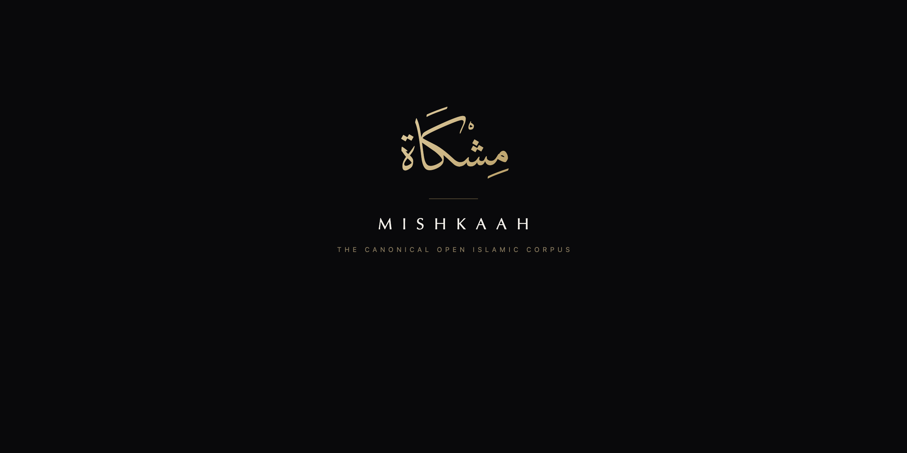
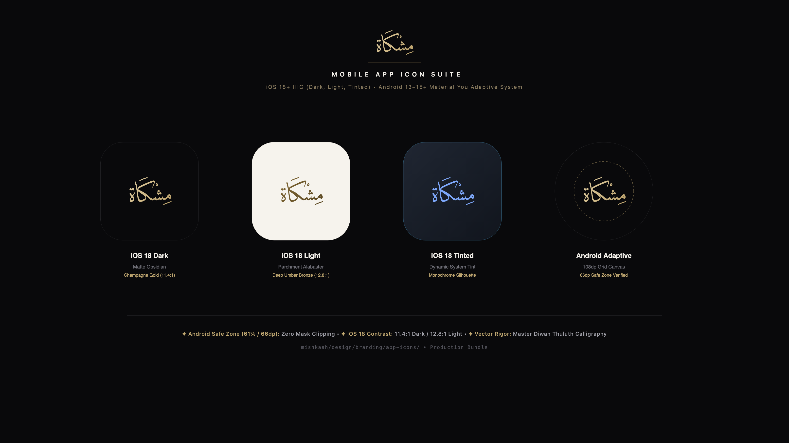
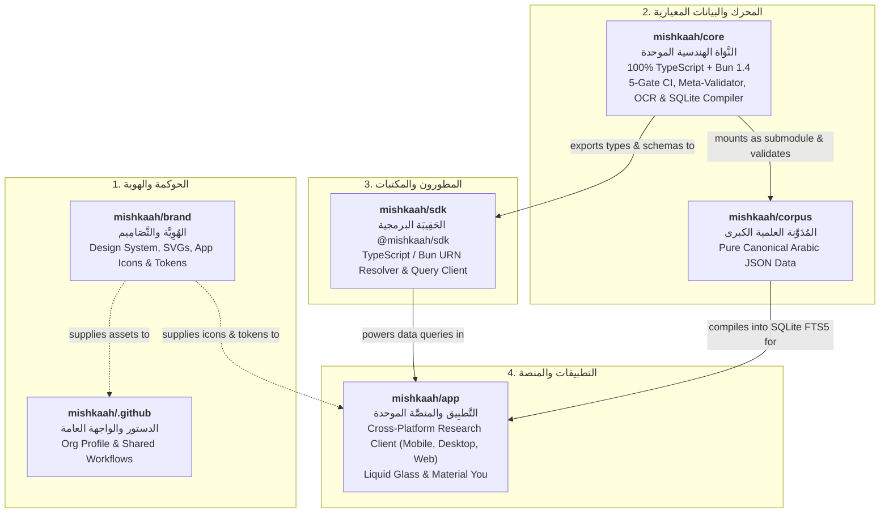

# 🏛️ مِشْكَاة | MISHKAAH
### المُدَوَّنَة الإِسْلَامِيَّة العِلْمِيَّة الكُبْرَى وَالْمَنَصَّة الهَنْدَسِيَّة الْمُوَحَّدَة
**The Sovereign Open Islamic Corpus & High-Performance Engineering Platform**

<div align="center">



[](https://github.com/mishkaah/corpus)
[](https://github.com/mishkaah/core)
[](https://github.com/mishkaah/brand)
[](https://github.com/mishkaah/sdk)
[](https://github.com/mishkaah/app)
[](https://github.com/mishkaah/core)

</div>

---

## 📖 1. الآية الكريمة والرؤية الهندسية | Spiritual Anchor & The Architectural Metaphor

يستمد مشروع **مِشْكَاة (Mishkaah)** اسمه ورؤيته الروحية من آية النور المباركة (سورة النور: ٣٥):

> **﴿اللَّهُ نُورُ السَّمَاوَاتِ وَالْأَرْضِ ۚ مَثَلُ نُورِهِ كَمِشْكَاةٍ فِيهَا مِصْبَاحٌ ۖ الْمِصْبَاحُ فِي زُجَاجَةٍ ۖ الزُّجَاجَةُ كَأَنَّهَا كَوْكَبٌ دُرِّيٌّ يُوقَدُ مِن شَجَرَةٍ مُّبَارَكَةٍ زَيْتُونَةٍ لَّا شَرْقِيَّةٍ وَلَا غَرْبِيَّةٍ يَكَادُ زَيْتُهَا يُضِيءُ وَلَوْ لَمْ تَمْسَسْهُ نَارٌ ۚ نُّورٌ عَلَىٰ نُورٍ ۗ يَهْدِي اللَّهُ لِنُورِهِ مَن يَشَاءُ ۚ وَيَضْرِبُ اللَّهُ الْأَمْثَالَ لِلنَّاسِ ۗ وَاللَّهُ بِكُلِّ شَيْءٍ عَلِيمٌ﴾**
> 
> *"Allah is the Light of the heavens and the earth. The example of His light is like a niche within which is a lamp; the lamp is within glass, the glass as if it were a pearlescent star lit from a blessed olive tree, neither of the east nor of the west, whose oil would almost glow even if untouched by fire. Light upon light. Allah guides to His light whom He wills..."*

### الأركان المعمارية الثلاثة للمنظومة | The Three Architectural Pillars

```
      +-------------------------------------------------------------+
      |                  المِشْكَاة (Al-Mishkah)                     |
      |   The Immutable Mathematical Niche: Git, TypeScript & CI    |
      |  +-------------------------------------------------------+  |
      |  |                الزُّجَاجَة (Al-Zujajah)                  |  |
      |  |    Pure Crystal Glass: Collation & Forensic Markup    |  |
      |  |  +-------------------------------------------------+  |  |
      |  |  |              المِصْبَاح (Al-Misbah)             |  |  |
      |  |  |      The Luminous Revelation: Quran & Sunnah    |  |  |
      |  |  +-------------------------------------------------+  |  |
      |  +-------------------------------------------------------+  |
      +-------------------------------------------------------------+
```

1. **المِشْكَاة (Al-Mishkah — The Wall Niche)**:  
   الوعاء الهندسي الحافظ الذي يجمع النور ويمنع تبدده: مستودعات برمجية غير قابلة للتلاعب (Immutable Git Repositories)، ومخططات ضبط بيانات صارمة (Strict Zod Schemas)، وبوابات فحص حتمية (5-Gate Deterministic CI)، ومراقب ميتا-هندسي (Layer 0 Meta-Validator) يحمي المنظومة برياضيات غير قابلة للاختراق.
2. **الزُّجَاجَة (Al-Zujajah — The Crystal Glass)**:  
   الصفاء النصي الفائق: نصوص عربية مضبوطة بالشكل التام، مقابلة سطرًا بسطر وحرفًا بحرف على أمهات الطبعات الخطية والمطبوعات المحققة المعتمدة (*المقابلة والتحقيق الجنائي*)، خالية من شوائب التوليد الآلي غير المنضبط.
3. **المِصْبَاح (Al-Misbah — The Radiant Lamp)**:  
   الوحي المعصوم والتراث العلمي الخالد: القرآن الكريم بالقراءات العشر المتواترة ورواياتها العشرين، والحديث النبوي الشريف بأسانيده وكتبه التسعة المعتمدة، والتفاسير المعتمدة، والمتون العلمية وشروحها، والمعجم اللغوي ثلاثي الطبقات.

---

## 🎨 2. فلسفة الهُوِيَّة البصرية والصمت الهندسي | Visual Identity & "Geometric Silence"

تنتهج مِشْكَاة مبدأ **الصمت الهندسي (Geometric Silence)**: جلال التراث ومهابته يستوجبان التواضع والوقار، والابتعاد التام عن الزخارف المصطنعة والرموز البدائية الرخيصة.

<div align="center">

| الختم السيادي الشريف | المنظومة الأيقونية لأنظمة الهواتف المحمولة |
| :---: | :---: |
|  |  |
| **The Sovereign Calligraphic Seal**<br/>خط الثلث الجلي الأصيل (*ديوان الثلث*) داخل مدار هالي عريض ($r=360\text{px}$) | **iOS 18+ HIG & Android 13–15+ Adaptive Icon Suite**<br/>رمز الطغراء المتماسك `مِشْكَاة` داخل منطقة الأمان الحتمية ($R=244.7\text{px} \ll 312\text{px}$) |

</div>

- **لوحة الألوان الأساسية**:
  - أسود الأوبسيديان المعتم (**Matte Obsidian** `#09090B`) — سكون المحراب والعمق الفضائي.
  - ذهب الشمبانيا السائل (**Champagne Gold** `#E5CFA0` → `#B89655`) — تباين ملكي بنسبة `11.4:1` (يتجاوز معايير WCAG AAA).
  - رق الألباستر الكريمي (**Parchment Alabaster** `#F6F3EC`) — سكينة القراءة الورقية الكلاسيكية وحبر البرونز الداكن (`12.8:1`).
- تفاصيل الهوية الكاملة وملفات التصميم المفتوحة: 👉 [`mishkaah/brand`](https://github.com/mishkaah/brand).

---

## 📜 3. الدستور الصارم لتوثيق وصيانة البيانات | The 7 Ironclad Rules of Data Authenticity

لضمان سلامة التراث الإسلامي الرقمي للأجيال القادمة، تخضع منظومة مِشْكَاة لسبعة مبادئ علمية وهندسية صارمة لا تقبل الاستثناء:

### ١. التوثيق المطبوع والمخطوط المقيد (`SOURCES_MANIFEST.json`)
لا يُقبل أي نص في المُدونة دون إسناده إلى طبعة محققة معتمدة أو مخطوط أصيل (مثل: مجمع الملك فهد لطباعة المصحف الشريف، دار المنهاج، مؤسسة الرسالة، دار التأصيل). تخضع النسخ المصورة والـ PDF لتدقيق بصري وتقاطع مع مصادر الإدخال الثنائية المتزامنة، مع تسجيل بيانات الطبعة والمحقق وسنة النشر ورقم الإيداع بدقة متناهية.

### ٢. المركزية العربية المطلقة والترجمات الانفصالية (Arabic-First & Stand-Off Translations)
النصوص الأصلية في قلب المنظومة (`matns/`، `explanations/`، `entities/`، `lexicons/`) عربية ١٠٠٪ بنسبة تشكيل كاملة. لا تُخلط الترجمات الأجنبية في ذات السجلات؛ بل تُحفظ الترجمات (الإنجليزية وغيرها) في طبقات انفصالية منفصلة (`corpus/translations/en/`) ترتبط بالنص العربي الأصيل عبر معرّف المورد الموحد (`target_urn`).

### ٣. السجل الأنطولوجي السداسي والربط الداخلي غير المشوّه (Universal 6-Domain Graph)
تُربط كافة الأعيان والمفاهيم الواردة في النصوص (الأشخاص `identity`، الأماكن `place`، الجماعات `group`، الوقائع `event`، المصطلحات الفنية `term`، والآثار المادية `object`) عبر وسوم مضمنة ذكية `[النص](mishkah:...)`. ويحكم هذا الوسم قانون رياضي حتمي:
$$\text{stripInlineRefs}(\text{text\_annotated\_ar}) \equiv \text{text\_ar}$$
أي أن إزالة وسوم الربط تعيد النص العربي الأصيل حرفًا بحرف دون أدنى تشويه أو إخلال.

### ٤. البنية المعجمية العربية ثلاثية الطبقات (3-Layer Lexical Architecture)
يرتبط كل لفظ غريب في القرآن والحديث بنظام معجمي محكم يتألف من ٣ طبقات:
- **الطبقة الأولى (الجذور والمعاجم العامة)**: ربط اللفظ بجذره الثلاثي أو الرباعي في أمهات المعاجم (*لسان العرب*، *تاج العروس*، *القاموس المحيط*).
- **الطبقة الثانية (معاجم غريب الأثر والسياق)**: المعنى الدقيق في السياق التفسيري أو الحديثي (*غريب القرآن* لابن قتيبة، *النهاية في غريب الحديث* لابن الأثير).
- **الطبقة الثالثة (الاصطلاحات الشرعية التخصصية)**: التعريفات الأصولية والفقهية والكلامية للفظ عند أئمة الفن (*التعريفات* للجرجاني، *الكليات* لأبي البقاء).

### ٥. معايير TypeScript الصارمة للبيئة Bun 1.4 (`.strict()`)
تُبنى محركات المنظومة وأدواتها بنسبة **١٠٠٪ بلغة TypeScript** على بيئة تشغيل **Bun 1.4**:
- يُمنع منعًا باتًا استخدام `any`، `unknown`، `z.any()`، `z.unknown()`، أو التجاوز بـ `.passthrough()` أو `@ts-ignore`.
- جميع مخططات كائنات Zod تنتهي بالدالة `.strict()` وتعتمد الاتحادات الحرفية الصريحة (`z.enum([...])`) والتعبيرات النمطية المحددة.

### ٦. بوابات الفحص الحتمية الخمس ومراقب الميتا (5-Gate CI & Layer 0 Meta-Validator)
لا يُدمج أي طلب سحب (PR) في المنظومة إلا بعد اجتياز ٥ بوابات فحص حتمية:
1. **Gate 1**: مطابقة كافة السجلات لمخططات Zod الصارمة وتوثيق المصادر في `SOURCES_MANIFEST.json`.
2. **Gate 2**: فحص السلامة المعجمية والمطابقة التامة لخاصية نزع الروابط المضمنة.
3. **Gate 3**: فحص سلامة الرسم القرآني وتطابق الروايات والتفاسير.
4. **Gate 4**: مطابقة أسانيد الحديث ورتب الرجال والتسلسل الزمني للطبقات.
5. **Gate 5**: البناء التجميعي الحتمي لقاعدة SQLite FTS5 المضغوطة واختبارات الأداء اللحظي (<50ms).

ويحرس هذه البوابات **مراقب الميتا (Layer 0 Meta-Validator)**، المزود بحارس شجرة الإعراب المجردة (AST Guard)، وأقفال تجزئة SHA-256، وحزمة **السموم الاصطناعية (25 Poison Pills Canary Suite)** التي تزرع عينات بيانات فاسدة في الذاكرة للتحقق من يقظة المحرك وقدرته على رفض أي تلاعب بنسبة ١٠٠٪.

### ٧. الحوكمة اللامركزية وحتمية التوثيق المسبق (Issue-First Governance)
لا يُقبل أي تعديل أو إضافة بيانات إلا عبر مسألة موثقة (GitHub Issue)، مع تحديد النطاق بدقة، والتحقق المستمر من عدم كسر أي مسارات أو روابط نسبية.

---

## 🌐 4. خريطة مستودعات المنظومة | The 6-Repository Ecosystem Map

تتوزع منظومة مِشْكَاة على ٦ مستودعات رئيسية متكاملة تحت المظلة الرسمية [`https://github.com/mishkaah`](https://github.com/mishkaah):



| # | المستودع / Repository | الوصف والنطاق | التقنيات والبيئة |
| :---: | :--- | :--- | :--- |
| **1** | [**`mishkaah/.github`**](https://github.com/mishkaah/.github) | واجهة المنظمة الرسمية، ودستور التوثيق والسياسات المشتركة، وقوالب المسائل وسير عمل GitHub Actions. | Markdown, GitHub Actions |
| **2** | [**`mishkaah/brand`**](https://github.com/mishkaah/brand) | مستودع الهوية البصرية، والأختام السيادية المتجهة (SVGs)، وأيقونات الهواتف المحمولة (iOS 18 / Android)، وحزم رموز التصميم JSON. | SVG, High-Res PNG, JSON Tokens |
| **3** | [**`mishkaah/corpus`**](https://github.com/mishkaah/corpus) | المُدونة العلمية الكبرى: سجلات البيانات المعيارية الخالصة (القرآن، الحديث، التفسير، المتون، المعاجم، الأعيان)، وترجماتها الانفصالية. | 100% Pure Arabic JSON, Git Submodule |
| **4** | [**`mishkaah/core`**](https://github.com/mishkaah/core) | النواة الهندسية الموحدة: مخططات Zod، بوابات الفحص الخمس، مراقب الميتا، أدوات معالجة المخطوطات والـ OCR، ومُجمّع قواعد بيانات SQLite FTS5. | TypeScript, Bun 1.4, Zod, SQLite/FTS5 |
| **5** | [**`mishkaah/sdk`**](https://github.com/mishkaah/sdk) | حزمة المطورين الرسمية `@mishkaah/sdk`: محلل معرّفات الموارد (URN Resolver)، وأنواع TypeScript ومخططات التحقق، ومحرك الاستعلامات المحلي السريع. | TypeScript, Bun, npm package |
| **6** | [**`mishkaah/app`**](https://github.com/mishkaah/app) | التطبيق الموحد متعدد المنصات (iOS, Android, macOS, Windows, Linux, Web): قراءة وبحث فوري أوفلاين مع واجهة Liquid Glass وزجاج الأوبسيديان. | Flutter / Kotlin Multiplatform |

---

## 🤝 5. المساهمة والانضمام | Contributing & Scholarly Integrity

نرحب بالباحثين الشرعيين، وخبراء المخطوطات، ومهندسي النظم للمساهمة في بناء هذا الصرح التراثي الرقمي. يُرجى مراجعة [دليل المساهمة الموحد](https://github.com/mishkaah/core/blob/main/docs/01-governance-and-standards/contributing-guidelines.md) وقراءة شروط التدقيق قبل فتح أي طلب سحب.

**﴿وَقُلِ اعْمَلُوا فَسَيَرَى اللَّهُ عَمَلَكُمْ وَرَسُولُهُ وَالْمُؤْمِنُونَ﴾**
